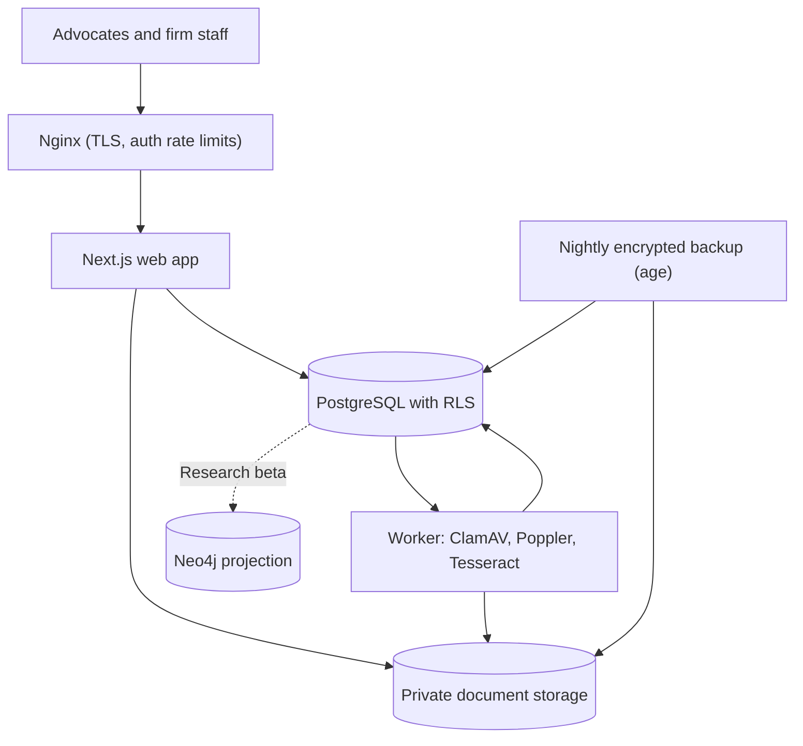

# NyayaFlow — Technical Architecture

**Status:** Implemented MVP architecture · **Date:** 27 September 2026  
**Stack selected:** Next.js on a self-hosted Node.js server; self-hosted PostgreSQL (data, row-level security, job queue); private filesystem document storage; a systemd document worker. Neo4j is planned for the Research beta.  
**Source:** `feature_specification.md` supplied by the product owner. Product scope and release gates are in `PRD.md`.

> **Stack decision (September 2026).** Earlier drafts assumed Supabase (Auth, Postgres, Storage, Queues) and a managed Neo4j instance. The MVP instead runs on a single India-hosted VPS (OVH Mumbai) with self-hosted components, so that every data path stays under the firm's operator control. This document describes the implemented design; `README.md` covers installation and operations.

## 1. Architecture goals

Build a secure, multi-tenant Indian legal practice platform with reliable matter records, searchable documents, attributable legal sources, and, from the Research beta, a citation graph. PostgreSQL is the canonical firm database. A future Neo4j graph will be a derived, rebuildable projection. External court, filing, signature, messaging, and payment integrations stay replaceable because their access and coverage differ by forum and provider.

### Guiding decisions

| Concern | Choice | Reason |
| --- | --- | --- |
| Web application | Next.js App Router with TypeScript, `output: standalone`, behind Nginx | Server-rendered workflows, route handlers, and client components where interaction is needed. |
| Canonical operational data | Self-hosted PostgreSQL 16 | Tenant, matter, document metadata, workflow, privacy, and audit tables with constraints, transactions, and row-level security. |
| Authentication | Application-owned: Argon2id passwords, mandatory TOTP MFA, opaque server-side sessions | No third-party identity processor. Roles and matter grants live in PostgreSQL. |
| File bytes | Private directory outside the web root (`DOCUMENT_STORAGE_ROOT`) | Originals are write-once per version. Bytes are streamed only after a per-request database authorization check. |
| Asynchronous work | `background_jobs` table claimed with `FOR UPDATE SKIP LOCKED` by a separate systemd worker | ClamAV scanning, page counting, and Tesseract OCR get durable retries with backoff and a dead-letter state. |
| Search | PostgreSQL full-text search over OCR pages | Organization-scoped and evaluated under the caller's RLS. Benchmark before adding a separate search system. |
| Legal relationship graph | Neo4j (Research beta, not in the MVP) | Judgment citations, treatment, and provision mappings as a projection fed from PostgreSQL. |
| AI | Optional OpenAI adapter, off by default, behind a data-classification gate | Internal and privileged data are always blocked. MVP OCR never calls an external model. |

### System context

The Next.js app serves the user-facing screens and a backend-for-frontend API under `/api/v1`. Every API route runs through one wrapper that resolves the session and active organization, applies role gates, validates input with zod, and maps database errors to safe messages with a correlation ID. `proxy.ts` rejects cross-origin, cookie-authenticated mutations. Database access runs as the non-owner `nyayaflow_app` role inside a transaction that sets `app.user_id`, so PostgreSQL row-level security decides visibility for every query. The worker uses a separate `nyayaflow_worker` role.

## 2. Service boundaries

- **Identity and tenancy:** `app_users`, `sessions` (12-hour absolute and 60-minute idle limits, revocable), TOTP enrolment with replay protection, sign-in throttling, `memberships`, `invitations`, and the active-organization cookie. An account alone grants no firm access.
- **Matter operations:** matters with forum identifiers and optional CNR, parties, lead advocate, restriction, and status. Hearings and tasks keep a reasoned edit history (`record_revisions`). Conflicts can be dismissed with a reason.
- **Court connector (Expansion):** forum adapters, permitted acquisition, provenance, freshness, and discrepancy review. The MVP is manual-source only.
- **Documents:** upload intents, streamed and checksummed uploads, quarantine, malware scan, OCR, immutable versions, corrections that preserve the original extraction, search, and authenticated downloads.
- **Legal intelligence (Research beta):** corpus ingestion with source rights, retrieval, answer generation with passage locators, and evaluation.
- **Graph projection (Research beta):** judgments, provisions, citation edges, and reviewed treatment in Neo4j.
- **Communications and commercial (Expansion):** consented notifications, invoices, advances, and reconciliation.
- **Platform administration:**
  - The superadmin is configured in the environment: email, encoded Argon2id hash, and TOTP secret.
  - It has its own sessions and audit log.
  - `SECURITY DEFINER` functions create organizations with a one-time owner invitation and list organization metadata; the web role still cannot insert organizations directly.
  - The console never reads tenant matters or documents.
- **Compliance and audit:** consent records, the data-request workflow with legal-hold checks, retention classes, legal holds, and a hash-chained audit log verified daily by the worker.

For the pilot these are modules in one Next.js codebase plus one worker process. Split into networked services only when scaling, team ownership, or isolation needs justify it.

## 3. Data ownership and mapping

PostgreSQL is the system of record. All tenant-owned tables carry `organization_id`. Composite foreign keys (`organization_id`, `matter_id`) guarantee that child rows belong to the same organization as their matter. Every exposed table has RLS enabled and forced.

| PostgreSQL table | Key fields / constraints | Purpose |
| --- | --- | --- |
| `app_users`, `sessions`, `auth_challenges`, `auth_throttle` | unique email; hashed session and challenge tokens | Credentials, MFA, sessions, throttling (pre-authentication, no RLS). |
| `organizations`, `memberships`, `invitations` | unique `(organization_id, user_id)`; hashed invitation tokens | Tenants, roles, onboarding. |
| `matters`, `matter_grants`, `parties` | organization + forum + reference; conditional CNR uniqueness | Matter lifecycle and access. |
| `hearings`, `tasks`, `record_revisions`, `conflict_dismissals` | organization + advocate + time indexes | Calendar, conflicts, workload, edit history. |
| `documents`, `document_versions`, `upload_intents` | storage path, SHA-256, status, version number | Immutable versions and quarantine. |
| `ocr_pages`, `ocr_corrections` | generated `tsvector`; per-page confidence | Search and correction history. |
| `consent_records`, `data_requests`, `retention_classes`, `legal_holds` | one active hold per matter | DPDP workflows. |
| `audit_events`, `audit_chain_heads`, `audit_verifications` | per-organization `chain_index`, SHA-256 chain | Tamper-evident audit trail. |
| `background_jobs`, `outbox_events` | status, lease, attempts | Durable processing and future projections. |
| `platform_sessions`, `platform_totp_steps`, `platform_audit_events` | hashed tokens; last TOTP step; append-only for the web role | Superadmin console sessions and audit. |

### Authorization design

`can_access_matter(matter, permission)` is the single source of matter permission:

| Role | Non-restricted matters | Restricted matters |
| --- | --- | --- |
| Every active member | View | Nothing, unless granted |
| Advocates, associates, paralegals | View and edit | Nothing, unless granted |
| Owners, managing partners, admins | Manage and export | Everything |

- **Explicit grants** (view, edit, manage, export, optionally expiring) add access on top of a role.
- **Matters SELECT policy:** judges each row from its own columns, so `INSERT … RETURNING` works for the row being inserted.
- **Restriction changes:** a trigger requires manage permission to change a matter's restriction and prevents moving a matter between organizations.
- **Owner memberships:** only owners can create or change them.
- **OCR corrections:** scoped to the matter, not the whole firm.
- **Web role privileges:** the web role may enqueue jobs but cannot read or claim them.

The helper functions are `SECURITY DEFINER` and read forced-RLS tables, so the schema owner role must have `BYPASSRLS`. Migration 002 refuses to run otherwise, because the helpers would recurse into their own policies.

A future Neo4j projection will use stable source IDs and carry `sourceRecordId`, `evidenceLocator`, `reviewState`, and extraction version on every relationship. Private matter information stays out of the shared public-law graph by default.

## 4. Core flows

### Matter and hearing records (MVP: manual source)

1. A user with edit rights creates a matter. The form validates CNR format and flags possible duplicates before saving.
2. Hearings and tasks are entered manually with IST times. Every later edit to time, advocate, status, deadline, or assignee requires a reason and is stored in `record_revisions`.
3. The daily board detects same-advocate overlaps and travel-buffer conflicts. A dismissal records the pair, the reason, and the actor.
4. Source state stays `manual` until an approved connector exists. The UI never labels manual data as live or verified.

### Document to search

1. **Upload intent:** the browser requests one after a matter check. The server derives the organization from the matter, creates a `document_versions` row (a new document, or the next version of an existing one), and issues a single-use, 15-minute token.
2. **Upload:** the browser streams the bytes. Size and SHA-256 must match the declared values before an atomic rename into private storage. The version then enters `quarantined` and a `malware_scan` job is queued.
3. **Worker:** scans with ClamAV, checks page count (at most 500 pages), and renders pages with Poppler. It runs one Tesseract pass per page outside any database transaction, then writes pages and status in one short transaction and audits the result.
4. **Search:** runs `document_search(query, organization)` under the caller's RLS and returns only `ready` versions. Corrections keep both the original extraction and every change.
5. **Download:** re-checks the session and matter permission on every request, streams with an RFC 5987 filename, and is audited. No bearer links are issued, so revocation is immediate.

### Audit chain

- **Writing events:** events are written in the same transaction as the change they describe. A trigger takes a per-organization advisory lock, reads the chain head from `audit_chain_heads`, and assigns the next `chain_index`. It then hashes a canonical JSON array of the event fields (UTC timestamp included) together with the previous hash.
- **Guards:** application roles cannot update or delete events.
- **Verification:** the worker runs `verify_audit_chain()` for each organization every 24 hours and records the result, which the Admin page shows. `restore-drill.sh` re-verifies chains after a restore.

## 5. API surface and interaction

All endpoints live under `/api/v1` and use cookie sessions. Mutations must come from the application origin, bodies are validated with zod, and errors return a correlation ID. Representative routes:

- **Matters:** `POST /matters`, `GET /matters/duplicates`, `PATCH /matters/{id}`
- **Hearings and tasks:** `POST /matters/{id}/hearings`, `PATCH /hearings/{id}`, `POST /matters/{id}/tasks`, `PATCH /tasks/{id}`, `POST /conflict-dismissals`
- **Access:** `POST|DELETE /matters/{id}/grants`, `POST /matters/{id}/legal-holds`
- **Members:** `POST /invitations`, `POST /invitations/accept`, `PATCH /members/{id}`
- **Platform console:** `POST /auth/platform/sign-in`, `GET|POST /platform/organizations`, `POST /platform/organizations/{id}/owner-invitations`
- **Sessions:** `GET|DELETE /sessions`, `POST /session/organization`
- **Documents:** `POST /documents/upload-intents`, `PUT /documents/uploads/{token}`, `GET /documents/{versionId}/download`, `GET /documents/versions/{id}/pages`, `GET /search`, `POST /ocr/pages/{id}/corrections`
- **Privacy:** `POST /privacy/consents`, `PATCH /privacy/requests/{id}`, `POST /retention-classes`, `PATCH /organization/policies`
- **Audit:** `GET /audit/export`

Long-running work returns immediately; the UI polls document status.

## 6. Security and privacy

- **Database roles.** RLS is enabled and forced on every tenant table. The web role (`nyayaflow_app`) holds narrow grants. The worker role bypasses RLS but has only the table grants it needs. The schema owner is used only for migrations and is never present in service environments. `npm run test:integration` runs automated tests against a real PostgreSQL instance covering tenant isolation, restricted matters, the role matrix, owner protection, job isolation, and audit tamper detection.
- **Authentication.**
  - MFA is mandatory for all staff.
  - TOTP codes cannot be replayed.
  - Sign-in and MFA attempts are throttled per account and per IP, and Nginx also rate-limits `/api/v1/auth/`.
  - Unknown accounts still run Argon2, so response timing doesn't reveal which emails exist.
- **Demo mode** is a server-only runtime flag; the server refuses to start with it in production.
- **Transport and headers.** CSP, HSTS, `X-Frame-Options`, and `nosniff` are set; fonts are self-hosted, so pages make no third-party requests.
- **Audit.** Events are append-only for application roles and hash-chained. This is tamper-evident, not immutable; do not claim WORM storage without WORM-capable backups.
- **Personal data.** Keep it out of telemetry and model prompts. Search terms are audited only as a hash. External AI is off by default and never receives internal or privileged data.
- **Residency.** PostgreSQL, documents, OCR, and backups stay on the India-hosted VPS and an India-hosted backup location. OVH Mumbai is a single availability zone, so keep an encrypted off-site copy in a separate India-hosted failure domain. Region selection alone does not prove legal compliance.
- **Client communications.** Client-facing messages (Expansion) require approval for sensitive matter changes.

## 7. Reliability, observability, and operations

**Proposed pilot SLOs:**
- 99.5% monthly availability, excluding scheduled maintenance.
- p95 API response under 800 ms at the agreed test load.
- Typical OCR jobs complete within 15 minutes.
- Court freshness is tracked per connector once connectors exist.

**Backups:** `scripts/backup.sh` runs nightly through a systemd timer. It produces encrypted (`age`) `pg_dump` archives and a document tarball with SHA-256 manifests, pruned after 30 days. It uses a read-only `BYPASSRLS` backup role.

**Restore drill:** `scripts/restore-drill.sh` restores into a scratch database and directory, verifies the checksums, audit chains, and every document hash. Run it before the pilot and on a schedule. Pilot targets are RPO 24 hours and RTO 4 hours. Tighten the RPO with WAL archiving if needed.

**Logs:** log structured errors with correlation IDs, plus worker job failures, dead-letter jobs, OCR confidence, and audit verification failures. Do not send protected legal text to general observability tools.

## 8. Deployment and release plan

- **MVP (built):**
  - Next.js web on an OVH Mumbai VPS behind Nginx with TLS.
  - PostgreSQL 16 with RLS.
  - A systemd worker (ClamAV, Poppler, Tesseract `eng+hin`).
  - Encrypted backups.
  - Secure matter, hearing, document, privacy, and audit workflows.
  - Manual court updates.
- **Deployment script:** `scripts/deploy-release.sh`:
  - type-checks, lints, and tests;
  - builds the web app and the bundled worker;
  - applies migrations as the schema owner;
  - atomically switches the release symlink and restarts the services.
- **Research beta:** a licensed corpus, retrieval with passage locators, a Neo4j citation projection fed from PostgreSQL outbox events, and reviewed treatment.
- **Expansion:** approved court connectors, the client portal, notifications, billing and advances.
- **Advanced:** filing rule packs, signature and e-stamp partners, contracts, and criminal-code transition tools.
- **Before each external integration:** confirm availability, permission, terms, test environment, data flow, pricing, incident ownership, and fallback.

## 9. Open design decisions

1. Approved sources and redistribution rights for judgments/statutes, citation metadata, and forum data.
2. Model vendor geography, and whether a private-model option is required before any AI feature uses client material.
3. Pilot forum coverage and freshness SLAs by court.
4. Neo4j hosting (co-located on the VPS or a separate India-hosted instance) and public-graph partitioning.
5. Retention and deletion rules for privileged material, legal hold, backups, and billing records; automatic deletion stays disabled until approved.
6. DSC signing route: supported platform bridge/provider or controlled desktop component; browser-only direct USB token access is not assumed.
7. Whether to add WAL archiving or a streaming replica to reduce RPO and RTO below the pilot targets.

## References checked

- [Next.js Route Handlers](https://nextjs.org/docs/app/getting-started/route-handlers)
- [Next.js Content Security Policy](https://nextjs.org/docs/app/guides/content-security-policy)
- [PostgreSQL Row Security Policies](https://www.postgresql.org/docs/16/ddl-rowsecurity.html)
- [PostgreSQL SELECT … FOR UPDATE SKIP LOCKED](https://www.postgresql.org/docs/16/sql-select.html#SQL-FOR-UPDATE-SHARE)
- [PostgreSQL pg_dump](https://www.postgresql.org/docs/16/app-pgdump.html)
- [OWASP Password Storage (Argon2id)](https://cheatsheetseries.owasp.org/cheatsheets/Password_Storage_Cheat_Sheet.html)
- [RFC 6238 TOTP](https://www.rfc-editor.org/rfc/rfc6238)
- [Neo4j Cypher indexes](https://neo4j.com/docs/cypher-manual/current/indexes/)
- [eCourts Services](https://services.ecourts.gov.in/ecourtindia_v6/casestatus/)
- [Controller of Certifying Authorities eSign](https://cca.gov.in/eSign.html)
- [MeitY DPDP Rules 2025](https://www.meity.gov.in/documents/act-and-policies/digital-personal-data-protection-rules-2025-gDOxUjMtQWa?pageTitle=Digital-Personal-Data-Protection-Rules-2025.pdf)
