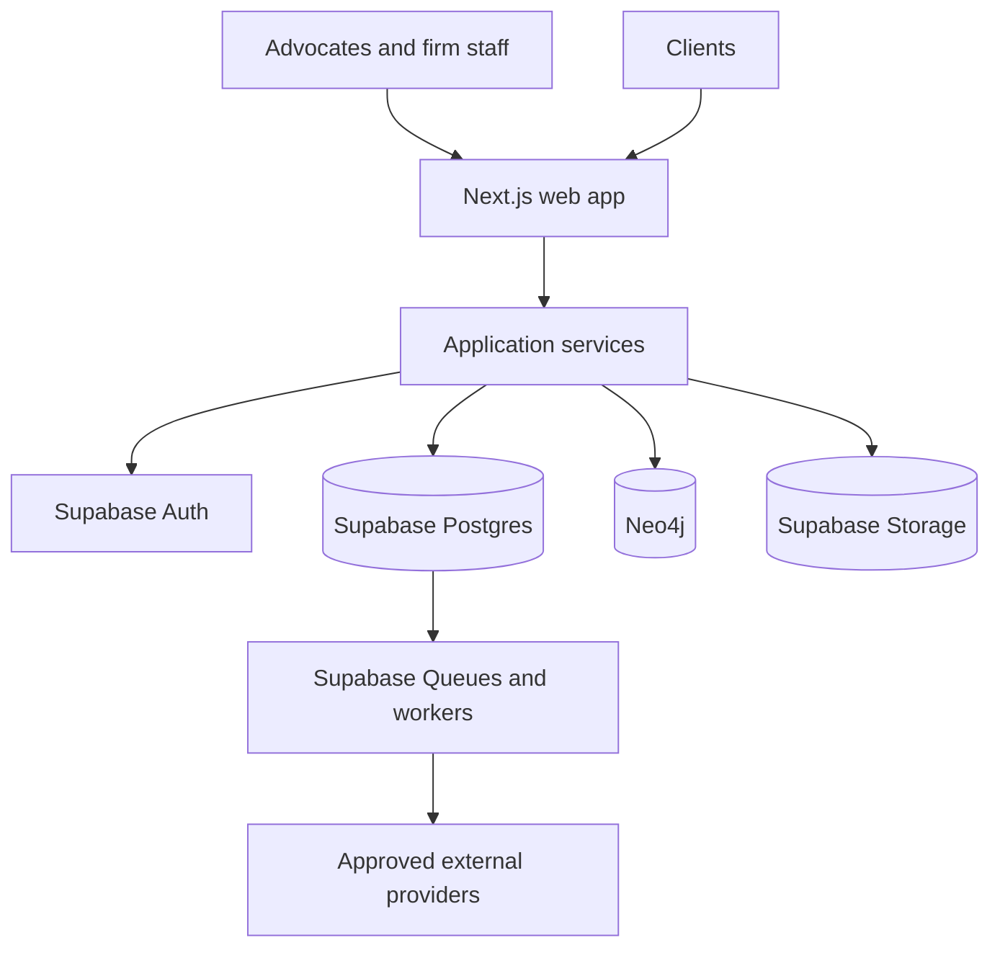

# NyayaFlow — Technical Architecture

**Status:** Proposed architecture · **Date:** 26 September 2026  
**Stack selected:** Next.js, Supabase (Postgres, Auth, Storage), Neo4j  
**Source:** `feature_specification.md` supplied by the product owner. Product scope and release gates are in `PRD.md`.

## 1. Architecture goals

Build a secure, multi-tenant Indian legal practice platform with reliable matter records, searchable documents, attributable legal sources, and a citation graph. Use Supabase Postgres as the canonical firm database and keep Neo4j as a derived legal graph. Keep external court, filing, signature, messaging, and payment integrations replaceable because their access and coverage differ by forum and provider.

### Guiding decisions

| Concern | Choice | Reason |
| --- | --- | --- |
| Web application | Next.js App Router with TypeScript | Server-rendered workflows, route handlers, and client components where interaction is needed. |
| Canonical operational data | Supabase Postgres | Relational tenant, matter, document metadata, workflow, finance, and outbox tables with constraints and transactions. |
| Authentication | Supabase Auth | Staff and client identities; Next.js server-side cookie sessions; app roles and matter grants remain in Postgres. |
| Legal relationship graph | Neo4j | Judgment citations, subsequent treatment, statute references, provision mappings, and explainable graph traversal. |
| File bytes | Supabase Storage private buckets | PDFs/scans are stored as private objects; immutable version metadata and paths live in Postgres. |
| Asynchronous work | Supabase Queues (pgmq), Cron, and isolated Node.js workers | OCR, court ingestion, notifications, indexing, exports, and graph projections need durable retries; assess workload quotas before selecting worker runtime. |
| Search | Postgres full-text search, optionally pgvector | Tenant-filtered document/passages search is distinct from Neo4j relationship traversal; benchmark before adding a separate search system. |
| AI | Retrieval service behind a model gateway | Ground outputs in licensed or otherwise permitted source documents with inspectable citations and human review. |

### System context

The Next.js app serves user-facing screens and a backend-for-frontend layer. Supabase Auth authenticates browser and server requests. Postgres RLS, SQL grants, and domain services enforce tenant, matter, and role permissions. Scoped browser access may use Supabase clients under RLS; privileged workflows and Neo4j access go through trusted server code. Workers alone perform scheduled ingestion and expensive processing.

## 2. Service boundaries

- **Identity and tenancy:** Supabase Auth users, MFA and sessions; application-owned `memberships`, `matter_grants`, client links, seats, and billing entitlement in Postgres. An Auth identity alone grants no firm access.
- **Matter operations:** CNR and forum identifiers, parties, hearings, deadlines, tasks, activity, proxy briefs, and client-visible events.
- **Court connector:** forum-specific adapters, permitted data acquisition, normalization, source provenance, freshness, discrepancy review, and retry controls.
- **Documents:** private uploads, malware scan, OCR, versioning, indexing, preview, export, and retention.
- **Legal intelligence:** corpus ingestion, source licensing/rights, chunking, hybrid retrieval, answer generation, citation verification, and evaluation.
- **Graph projection:** judgments, provisions, citation edges, treatment assertions, provenance, and analyst review.
- **Communications:** consent/preferences, templates, approvals, notification scheduling, delivery states, and webhooks.
- **Commercial:** SaaS subscriptions, firm invoices, matter fees and expenses, payment reconciliation, and retainer ledger.
- **Compliance and audit:** policy configuration, access logs, deletion workflow, export, incident records, and evidence of approvals.

For an initial deployment these are modules in one Next.js/Node.js codebase plus separately deployed workers. Split into networked services only when scaling, team ownership, or isolation needs justify it.

## 3. Data ownership and mapping

Supabase Postgres is the system of record for firm data. Supabase Auth owns credentials and sessions, while application roles and matter grants live in relational tables. Neo4j is a rebuildable legal knowledge projection; never use an unverified graph edge as the sole authority for a legal conclusion. Every private table has `organization_id` where relevant, foreign keys, scoped unique constraints, indexes, and RLS policies. Keep privileged internal tables in a non-exposed schema; grant Data API access only deliberately.

| Postgres table | Key fields / constraints | Purpose |
| --- | --- | --- |
| `organizations`, `profiles`, `memberships` | Auth `user_id` FK, unique `(organization_id, user_id)` | Tenant and role management. |
| `matters`, `matter_grants` | organization + matter; conditional court/CNR uniqueness | Matter lifecycle and access. CNR is optional for unsupported forums. |
| `hearings`, `tasks` | organization + date + assignee indexes | Calendar, conflicts, and workload. |
| `documents`, `document_versions` | organization + matter; private bucket/path, hash, status | Immutable versions and Supabase Storage references. |
| `source_records`, `connector_runs` | source ID, observed_at, checksum, parser version | Court provenance, deduplication, freshness. |
| `notifications`, `delivery_attempts` | unique idempotency key; channel/state | Outbound communication. |
| `invoices`, `retainer_entries`, `payments` | append-only ledger ID; unique external reference | Financial history and reconciliation. |
| `audit_events`, `outbox_events` | organization + time; event ID | Traceability and reliable projections. |
| `legal_sources`, `passages`, `answer_reviews` | source edition, locator, rights, verification state | Corpus and cited AI output. |

Suggested Neo4j labels: `Judgment`, `Provision`, `Statute`, `Court`, `Bench`, `Topic`; relationships: `CITES`, `DISTINGUISHES`, `FOLLOWS`, `OVERRULES`, `REFERENCES_PROVISION`, `MAPS_TO`. Every relationship carries `sourceRecordId`, `evidenceLocator`, `reviewState`, `effectiveFrom` when relevant, and extraction/version provenance. Use stable source IDs and scoped uniqueness constraints; organization-private graph nodes or edges require explicit tenant partitioning and query guards. Prefer a separate shared public-law graph and keep private matter information out of it by default.

### Supabase authorization design

Use `auth.users.id` as the identity key, with application membership in `memberships(organization_id, user_id, role)` and restricted access in `matter_grants(matter_id, user_id, permission)`. RLS policies on `matters`, child tables, and document metadata check these tables; policies for `storage.objects` check the corresponding document/version row and operation. Index the policy lookup keys and test role changes and revocation. A bucket path alone is not an authorization decision. Keep service-role access limited to trusted server workers and never expose the secret key in client code. For the most sensitive files, proxy authenticated downloads through a server authorization check so a later revocation is enforceable on each request.

## 4. Core flows

### Matter/court sync

1. User creates a matter with court, case identifier, and permitted CNR if available.
2. Connector records source terms/permission, fetches through an approved channel, normalizes identifiers, and stores raw provenance and checksum.
3. A comparison job proposes changes; high-impact changes (hearing date, order, case status) show the source and require a clear verification state.
4. A Postgres transaction writes accepted matter updates plus an `outbox_events` row.
5. A worker creates tasks or alerts once per idempotency key. UI shows `last checked`, `source updated`, and `needs verification` separately.
6. Failure leaves the last confirmed state intact and surfaces staleness. Manual entry remains available.

### Document to research

1. Authenticated browser requests an upload intent after a matter-grant check. Server assigns a unique immutable object path in a private Supabase Storage bucket; direct uploads use storage RLS or a narrowly scoped signed upload token, then finalize against the expected path and file metadata.
2. Upload remains quarantined until worker validates file type and malware status; the original object remains versioned by new path, while Postgres records hash, ownership, and reviewable page OCR text. Pending files cannot be shared or searched.
3. Indexer creates passage locators and tenant-scoped search index entries. A licensed public-law corpus follows its own ingestion and rights pipeline.
4. Retrieval filters access and source status before generation; answer includes source links, quoted passage locations, model/version, and uncertainty.
5. Citation validator checks passage existence and exact locator; unsupported statements are withheld or explicitly marked unverified. Reviewer edits are logged.

### Graph projection consistency

A Postgres transaction commits a domain change and an `outbox_events` row together. A trusted dispatcher enqueues to Supabase Queues or claims outbox rows with a lease, then a worker upserts graph nodes/edges by stable IDs, records a projection checkpoint, and acknowledges. Consumers are idempotent because jobs can be retried. A replay/rebuild job restores Neo4j from canonical records. Graph lag is observable, and UI avoids presenting stale treatment flags as current.

## 5. API surface and interaction

Use Supabase Auth SSR cookie sessions with server-side user verification. Use versioned Next.js route handlers for privileged browser requests, e.g. `POST /api/v1/matters`, `GET /api/v1/matters/{id}`, `POST /api/v1/documents/upload-intents`, `POST /api/v1/research/queries`, `GET /api/v1/citations/{judgmentId}`, `POST /api/v1/notifications/preview`, `POST /api/v1/invoices`. Validate schema and organization/matter grant at every endpoint. Use CSRF controls for cookie-authenticated mutations, rate limits, short session expiry, and idempotency keys for payments/messages/ingestion. For long jobs, return a job ID and poll or use server-sent events; do not hold a request open through OCR or external provider delays.

## 6. Security and privacy

- Enable RLS on exposed Postgres tables and `storage.objects`, and grant SQL privileges narrowly. RLS policies derive membership and matter grants from database tables, not user-editable metadata. Test cross-tenant isolation across direct client queries, routes, cached views, workers, Neo4j, and file paths. Keep secret/service-role credentials server-only; these bypass RLS.
- Use Supabase Auth MFA for staff where supported/configured; client portal has explicit matter grants. Prefer authenticated downloads for sensitive files requiring immediate access revocation. Signed download URLs are short-lived bearer links and remain valid until expiry after a user is revoked. Keep service keys and provider secrets only in trusted server environments.
- Record append-only audit events with tamper-evident hash chaining and restricted export; avoid claiming absolute immutability unless backed by WORM-capable storage and retention controls.
- Keep personal data out of telemetry and model prompts unless needed and authorized. Define lawful basis/notice, retention, erasure exceptions, breach process, and vendor agreements with counsel.
- Choose Supabase South Asia (Mumbai, `ap-south-1`) for primary project data if India residency is required; verify Storage, backups, Auth, logs, Neo4j, OCR, AI, and provider data flows. Region selection alone is not proof of legal compliance.
- Make client-facing messages approval-based for sensitive matter changes. Do not disclose content in lock-screen notifications by default.

## 7. Reliability, observability, and operations

Target initial SLOs: 99.5% monthly app availability (excluding scheduled maintenance); p95 ordinary API response under 800 ms at agreed test load; background job completion within 15 minutes for typical OCR files; court freshness tracked per connector rather than promised globally. These are proposed targets to validate with pilot volume.

Back up Supabase Postgres, Storage objects, Auth recovery data as supported by the service, and Neo4j with restoration drills and key recovery; define RPO 1 hour/RTO 4 hours as pilot targets. Log structured request/job IDs, ingestion freshness, parser errors, graph lag, OCR confidence, citation-check failure, notification delivery, and audit integrity. Avoid sending protected legal text to general observability tools.

## 8. Deployment and release plan

- **MVP:** Next.js app; Supabase project in chosen region with Postgres, Auth, private Storage, RLS, Queues/Cron as appropriate; managed/private Neo4j; isolated workers; manual court updates plus 1–2 approved connectors; secure matter/document workflows; basic citation graph from licensed corpus.
- **Phase 2:** broaden approved connectors, client portal, notifications, validated research and graph treatment review, basic financials.
- **Phase 3:** filing defect packs, signature/e-stamp partners, contract workflow, broader OCR languages, validated code transition tools.
- **Before each external integration:** confirm availability, permission, terms, test environment, data flow, pricing, incident ownership, and fallback.

## 9. Open design decisions

1. Approved sources and redistribution rights for judgments/statutes, citation metadata, and forum data.
2. Hosting and model vendor geography; whether a private-model option is required.
3. Pilot forum coverage and freshness SLAs by court.
4. RLS policy design, enterprise tenant isolation, and public graph partition strategy.
5. Retention and deletion rules for privileged material, legal hold, backups, and billing records.
6. DSC signing route: supported platform bridge/provider or controlled desktop component; browser-only direct USB token access is not assumed.

## References checked

- [Next.js Route Handlers](https://nextjs.org/docs/app/getting-started/route-handlers)
- [Supabase Postgres and backups](https://supabase.com/docs/guides/database/overview)
- [Supabase Auth with Next.js](https://supabase.com/docs/guides/auth/quickstarts/nextjs)
- [Supabase Row Level Security](https://supabase.com/docs/guides/database/postgres/row-level-security)
- [Supabase Storage access control](https://supabase.com/docs/guides/storage/security/access-control)
- [Supabase private downloads](https://supabase.com/docs/guides/storage/serving/downloads)
- [Supabase Queues](https://supabase.com/docs/guides/queues)
- [Supabase regions](https://supabase.com/docs/guides/platform/regions)
- [Neo4j Cypher indexes](https://neo4j.com/docs/cypher-manual/current/indexes/)
- [eCourts Services](https://services.ecourts.gov.in/ecourtindia_v6/casestatus/)
- [Controller of Certifying Authorities eSign](https://cca.gov.in/eSign.html)
- [MeitY DPDP Rules 2025](https://www.meity.gov.in/documents/act-and-policies/digital-personal-data-protection-rules-2025-gDOxUjMtQWa?pageTitle=Digital-Personal-Data-Protection-Rules-2025.pdf)
